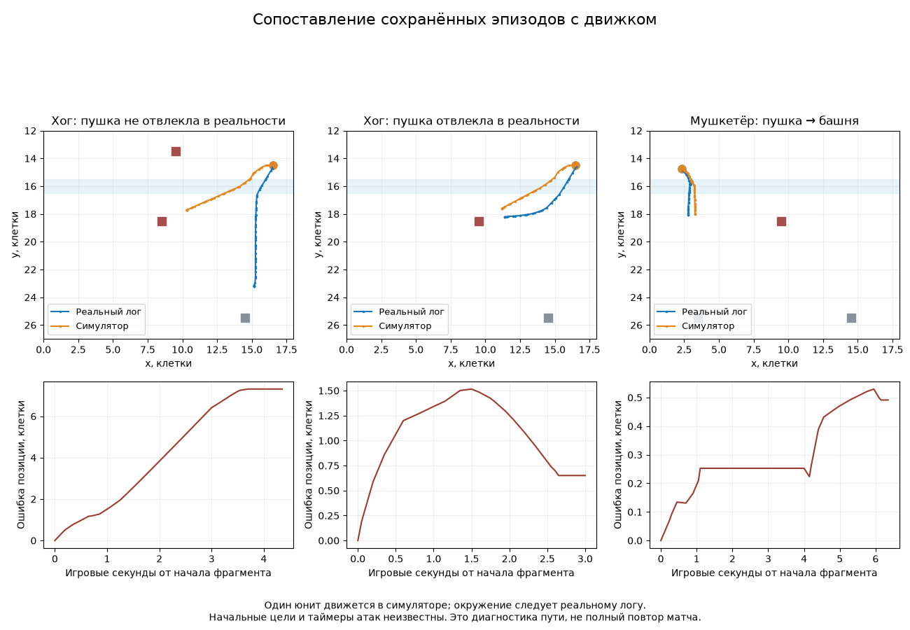

# Реальные эпизоды против симулятора: первое исправление

**Исправлены скорости снарядов Cannon и Archer. У хога воспроизведён неверный путь к пушке; его исправление ещё не принято.** Новых матчей и обучений в этой работе не запускали. Старые загруженные Kaggle-пакеты содержат прежнюю физику; текущая правка не меняет их задним числом.

## Что действительно исправлено

| Снаряд | Реальная скорость, медиана, клеток/с | Было в движке | Стало | Непрерывных фрагментов / файлов |
|---|---:|---:|---:|---:|
| Пушка | 19,989 | 16,666 | 20 | 8 / 4 |
| Лучница | 11,990 | 10 | 12 | 26 / 2 |
| Мушкетёр | 19,994 | 20 | 20 | 75 / 5 |
| Fireball | 11,988 | 12 | 12 | 25 / 5 |

В пяти исходных файлах медианная частота часов — **19,995 Гц**,2815 интервалов. Каждый фрагмент сохраняет мир, адрес и ID; часы frame/own должны совпадать. Разрывы >5 тиков, исчезновение снаряда, противоречивые дубли тика и нелинейные траектории не склеиваются. Остаток линейной аппроксимации≤10 милли-клеток. Повторные выстрелы внутри одного матча не являются независимыми матчами.

На **наблюдаемом участке полёта**, не от рождения до попадания, медианная лишняя длительность у Cannon снизилась с49,84 мс до−0,14 мс; у Archer — с79,36 до−0,36 мс. Отрицательная доля миллисекунды — округление/шум координат, не точность часов до микросекунды. Отдельный тест настоящего `Battle.step()` подтверждает нанесение урона Cannon на дистанции5 клеток через250 мс вместо300; Archer на6 клетках — через500 вместо600. В этих тестах выстрел явно готов в момент0.

Изменён `sim/projectile_calibration.py`; обе ветки загрузки, локальная и переносимая публичная, используют эту калибровку. Неизвестные типы и изменившиеся исходные значения скорости не получают множитель20 автоматически. [Все измерения, координаты и SHA источников](defense_plan/recorded_projectile_clips_20261028.json).

## Хог и мушкетёр: фактические траектории

Это **повтор движения одного юнита с окружением из реального лога**. Позиции, HP, появление и исчезновение остальных тел берутся из записи; их AI не исполняется. Фокусный юнит выбирает цели и двигается через настоящие `_acquire_target/_attack/_move` движка. Его позиция не подправляется под запись. Начало — после завершения появления; начальная цель и фаза атаки неизвестны. Столкновения, внешние баффы, урон окружения и отбрасывание здесь не восстановлены. Поэтому это диагностика пути и таргетинга, **не полный независимый повтор боя**.

| Реальный эпизод | Игровые тики | Ошибка позиции, средняя / максимум | Вывод |
|---|---|---:|---|
| Хог справа → Cannon(8,5;18,5) | 2347–2434 | 4,06 / 7,31 клетки | Реальный хог проходит к Princess, симулятор уводит к Cannon |
| Хог справа → Cannon(9,5;18,5) | 1456–1516 | 1,02 / 1,52 клетки | Оба пути ведут к Cannon, но форма и время пути отличаются |
| Musketeer → Cannon → Princess | 968–1095 | 0,30 / 0,53 клетки | Последовательность целей совместима; совпадение всех таймеров не установлено |

Первые два эпизода — один и тот же реальный бой `tower_support/recovery`, поэтому разница координаты Cannon особенно полезна, но окружение и время постановки всё же различаются. Это не контролируемый эксперимент с единственной переменной.

В первом эпизоде HP Princess уменьшается на218 в интервале тиков(2430;2433]; симулированный хог в это время находится у Cannon. Это наблюдаемая потеря HP; native target/source damage pointer отсутствует. Весь реальный бой и точное число ударов этой диагностикой не воспроизведены.

Внутри перехода через реку оба реальных хога движутся с медианной скоростью**3,176 клетки/с**. Обычная скорость движка —2,4; профиль содержит `JumpSpeed=3,2`, но это поле не переносится в `Entity` и не применяется к движению. Одновременно нынешний маршрут ведёт через центры клеток моста. Просто ускорить любую точку у реки недостаточно: нужно восстановить начало, конец и фиксацию направления прыжка. Этот дефект **выявлен, но пока не исправлен**.

Для мушкетёра первая новая пуля к Cannon появляется между тиками1003 и1006; replay с нулевой начальной перезарядкой стреляет на992. Это **не доказанные550–700 мс ошибки движка**: начальная перезарядка неизвестна, а предыдущий выстрел был ещё до начала фрагмента. Требуется начать с предыдущего подтверждённого выстрела и восстановить фазу, а не подгонять load time. Последующие реальные выстрелы совместимы с периодом1 с.

Исходные небольшие фрагменты с полным контекстом: `data/recorded_mechanics_20261028/`. [Покоординатный replay, переключения целей и реальные падения HP](defense_plan/recorded_episode_replay_20261028.json). Последние записаны без приписывания каждому падению конкретного атакующего.

## Проверенная и отклонённая простая правка

Проверили гипотезы sight5,5/6,5/7,5/9,5 после реального перехода через реку. Это позволяет убрать из проверки начальную ошибку прыжка, но не восстанавливает предыдущую цель.

| Выборка | Эпизодов | Средняя ошибка при9,5 →5,5 | Улучшилось / ухудшилось / без изменения |
|---|---:|---:|---:|
| Пять исходных файлов | 15 | 1,192 →0,300 клетки | 4 / 0 / 11 |
| Дополнительные записи других серий | 21 | 0,560 →0,445 клетки | 3 / 2 / 16 |

Граница изменения —0,02 клетки средней ошибки. Случаи внутри матчей коррелируют; дополнительные записи — расширенная диагностика, не независимый test нового симулятора. В двух ухудшениях хог мог уже держать Cannon целью до нашего старта. Изменение общего sight также меняет видимость башен и удержание целей. **Глобальная замена9,5→5,5 отклонена**: различить первоначальный захват, удержание старой цели и путь до прыжка важнее, чем улучшить среднее число.

[Исходные15 эпизодов](defense_plan/hog_postriver_discovery_20261028.json), [дополнительный21 эпизод](defense_plan/hog_postriver_additional_20261028.json). Результаты не дают точного истинного радиуса притяжения.

## Fireball и Balloon: границы проверки

- Fireball: проверены25 непрерывных полётов; текущая скорость согласуется с записью. **Радиус попадания, точка взрыва, урон и отбрасывание ещё не подтверждены этим сравнением.** Исчезновение снаряда между двумя снимками не сообщает точную точку прицеливания противника.
- Balloon: поиск во всех25 сохранённых `tmp/live/**/frames.jsonl` не обнаружил имени Balloon. [Список и SHA файлов](defense_plan/balloon_capture_inventory_20261028.json). Это не доказывает отсутствия шара на экране, если парсер не распознал тело. Сейчас нет подходящего native-эпизода для честного сравнения его пути; симулированный пример не заменяет реальную запись.

## Проверки и следующие действия

25 профильных тестов проходят. С расширенным `test_ranged_damage.py`:76 проходят,4 падают. Те же4 падения воспроизведены **до изменения калибровки**, отключением только двух новых записей в отдельном процессе: устаревшие имена `super_archer/super_archers`, отсутствующие `princess_ev1`, `axe_man_ev1`. Полный набор не объявляется зелёным.

1. Восстановить захват/удержание цели и фазу прыжка хога на этих фрагментах плюс дополнительные записи. Проверять обе стороны и реальные обходы Cannon, а не только успешные притяжения.
2. Начинать таймерный replay мушкетёра с предыдущего выстрела; отдельно сопоставить момент первого снаряда Cannon и последовательные попадания, не используя обнулённые таймеры как доказательство соответствия.
3. Связать свои Fireball с подтверждённой командой и конечной нативной точкой, затем проверить границу области, сдвиг и HP. Для Balloon сначала получить пригодный реальный фрагмент.
4. Только после механических проверок пересобрать отдельный пакет обучения с новым SHA физики; результаты уже идущего пакета не выдавать за обучение на этих исправлениях.

Повторение: `.venv-live/bin/python -m scripts.gamestate.report_episode_replay --output /tmp/NEW_REPLAY.json --plot /tmp/NEW_REPLAY.png`. Файлы должны ещё не существовать. Скрипты `audit_projectile_motion_clips` и `audit_hog_pull_replay` принимают список исходных JSONL и `--output`; использованные пути и хэши находятся в соответствующих отчётах.
